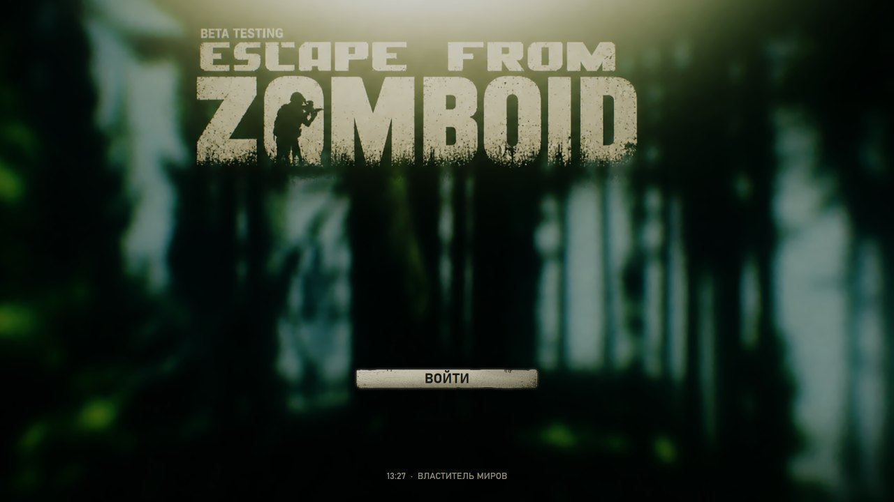
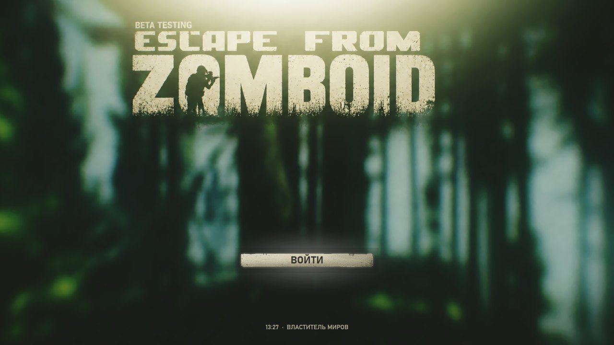

# Tarkov Windows UI

Escape From Tarkov–style look for Windows 10/11: a full-screen welcome screen with one big button (*ВОЙТИ* by default, any text you like), Tarkov cursors system-wide and Tarkov UI click / hover sounds everywhere on the desktop.

Built on top of the assets of the Project Zomboid mod **Tarkov Style [Escape From Tarkov Menu UI/SFX]**.



## Features

- **Welcome screen after logon.** Mouse-driven parallax background, the original menu button with hover glow, press-in, bounce, flash and camera push-in on click. GPU-rendered (WPF), runs at your monitor's refresh rate.
- **Tarkov cursors.** Arrow, hand (links) and busy cursors are replaced for the current user. Your old cursors are backed up and restored on uninstall.
- **Click sounds everywhere.** Left and right clicks play the Tarkov button click.
- **Hover sounds.** Hovering desktop icons, Explorer files and folders, taskbar buttons, menus and buttons plays the Tarkov hover sound. Muted in browsers and full-screen games.
- **Lightweight.** Two tiny executables (~25 KB in total), no dependencies, no admin rights, no .NET SDK. Only uses what ships with Windows.



## Quick start

1. Download the latest ZIP from [Releases](../../releases) and unpack it anywhere.
2. Double-click **`install.bat`**.
3. Done: the cursors change right away, the sounds start in the tray (shield icon), and the welcome screen will show at every logon.

To remove everything, double-click **`uninstall.bat`**. It restores your old cursors and removes the autostart entries and installed files.

## Customize

| What | How |
|---|---|
| Button text | Create `data\label.txt` with your text (UTF-8) |
| Name under the button | Edit `data\name.txt` |
| Welcome screen manually | Run `%LOCALAPPDATA%\TarkovWin\TarkovWelcome.exe` |
| Close the welcome screen without clicking | `Esc` |
| Stop the sounds | Right-click the shield icon in the tray → *Выход* (Exit) |

Re-run `install.bat` after editing files in `data`.

## Build from source

```bat
build.bat
```

This uses `csc.exe` from .NET Framework 4.x, which is present on every Windows 10/11 machine.

`tools\make_cursors.py` (needs Pillow) converts the mod's PNG cursors to `.cur`:

```bat
python tools\make_cursors.py tools\TarkovMenu_cursor_silver.png data\arrow.cur
```

## How it works

- `TarkovWelcome.exe` is a borderless top-most WPF window. The parallax runs on `CompositionTarget.Rendering`, and the button animations use WPF easing (Back / Cubic / Quadratic).
- `TarkovShell.exe --daemon` installs a low-level mouse hook (`WH_MOUSE_LL`) for clicks. Sounds are queued to a separate audio thread, so the hook returns immediately and never lags the cursor. Hover detection polls the element under the cursor through MSAA (`AccessibleObjectFromPoint`) and plays only for interactive roles (list items, buttons, menu items, tabs, tree items). It is debounced so one element plays once.
- Cursors are set in `HKCU\Control Panel\Cursors` and applied with `SystemParametersInfo(SPI_SETCURSORS)`. Autostart uses `HKCU\...\Run`, so nothing is system-wide.

## Notes

- The real Windows sign-in screen (password entry) can't be replaced safely. Only a credential provider DLL can draw there, and a bug in one locks you out of the PC. This project shows its screen right after sign-in instead. With auto-logon enabled, that screen is the first thing you see after boot.
- Windows 10 / 11, current user only, no admin needed.

## Credits

- UI art, cursors and sounds come from the Project Zomboid Workshop mod [Tarkov Style [Escape From Tarkov Menu UI/SFX]](https://steamcommunity.com/sharedfiles/filedetails/?id=3830796987), which is based on *Escape From Tarkov* by Battlestate Games.
- All game assets belong to their respective owners and are included for non-commercial fan use. If you are a rights holder and want them removed, open an issue.
- Code: MIT, see [LICENSE](LICENSE).
